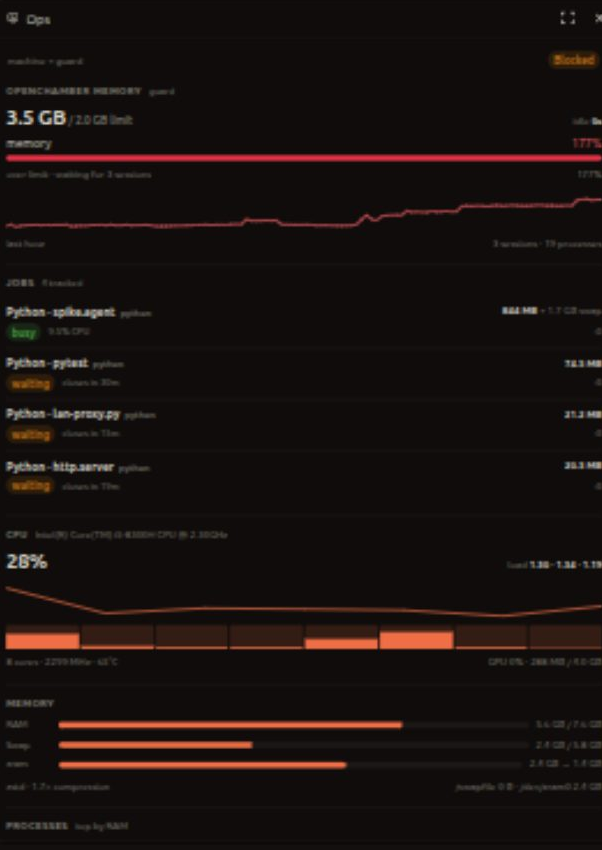
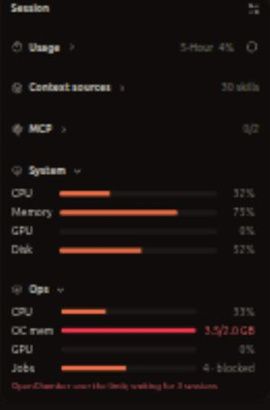
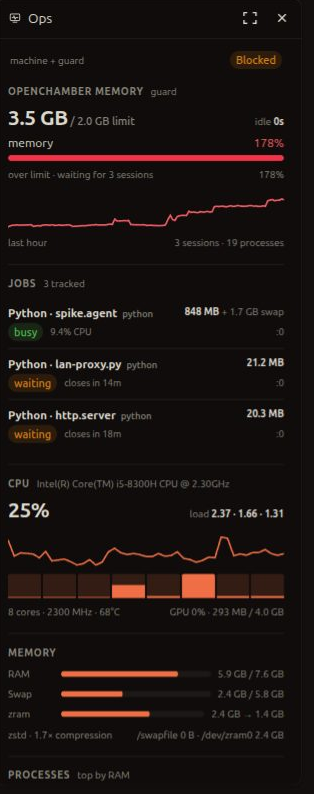

# Ops for OpenChamber

One rail panel for the machine and for **ocguard**: CPU, RAM, swap/zram, GPU, top processes, OpenChamber memory against the guard limit, tracked jobs, and the guard's recent actions. It is read-only — no close buttons, no restarts.



## What it shows

- **Guard**: OpenChamber memory vs the 2 GB limit, idle time, running sessions, process count, the guard's own memory history, and why it is or is not acting (`ok`, `blocked`, `restarting`).
- **Jobs**: every Gradle, Kotlin, llama.cpp or Python job ocguard tracks, with RSS + swap, state, CPU, unit/port, and the auto-close countdown.
- **CPU**: total and per-core usage, load average, frequency, package temperature, two-minute sparkline.
- **Memory**: RAM, swap, zram uncompressed → compressed, compression ratio, swap devices.
- **Processes**: top eight by RAM, with CPU, swap, and GPU type/SM for GPU processes.
- **History**: recent ocguard restarts and job closures with memory reclaimed.
- **Work Status**: a compact four-row section (CPU, OC memory, GPU, jobs) plus a warning badge on the rail icon.



## Install

You need OpenChamber 2.0.1 or newer, on desktop or web.

1. Open **Settings → Extensions**.
2. Paste `https://github.com/ArpanSM/openchamber-ops` and choose **Add**.
3. Allow the local service when asked. It runs `nvidia-smi`, `ps` and `zramctl`; the guard data is read from `~/.local/state/ocguard/`.

A folder install also works for development: paste the absolute path of this folder instead of the URL, then rebuild and reload the window.

## Phone and tablet

The native OpenChamber mobile app does **not** load extension panels yet. The browser/PWA does, because it is the web UI.

- **Tablet**: open the OpenChamber web URL in the browser. The tablet layout already uses the desktop rail.
- **Phone**: open the same URL with `?surface=desktop` (for example `http://192.168.1.16:8080/?surface=desktop`). The right rail and panel fill the screen; add it to the home screen for a one-tap shortcut.
- The OpenChamber server listens on `127.0.0.1` by default. To reach it from another device, use **Settings → External tunnel** (needs a UI password and an app restart), Tailscale Serve, or the small LAN forwarder in `scripts/lan-forward.mjs`. The native app's private relay does not serve the PWA.

### LAN forwarder (optional)

`scripts/lan-forward.mjs` forwards a LAN port to the desktop app's loopback port so a phone or tablet on the same network can open the browser UI. It is a raw TCP proxy and adds no authentication, so only run it on a network you trust.

```bash
node scripts/lan-forward.mjs
# or
LISTEN_PORT=8080 TARGET_PORT=57123 node scripts/lan-forward.mjs
```

`scripts/oc-lan-forward.service.example` is a systemd user unit for keeping it running.



## How it reads the data

A local Node service starts with the extension and listens on loopback only. The panel never touches the system; it asks the service for `/stats`.

- **System, every 2 s**: CPU times from `os.cpus()`, `/proc/meminfo`, `/proc/swaps`, `zramctl`, `nvidia-smi`, `ps`, `/proc/<pid>/status`.
- **Guard, every 5 s**: `~/.local/state/ocguard/state.json` and the tail of `~/.local/state/ocguard/guard.log`. Nothing is executed and nothing is written. If the state file is older than 90 seconds, the panel shows the guard as offline.
- The service stops sampling 30 seconds after the last panel request.

## Development

```bash
npm install
npm run check       # typecheck + build
```

Then install the folder from **Settings → Extensions** and reload the window after each build. `dist/` is committed so a Git install works without a build step.

## Limits

- Linux-focused; NVIDIA GPUs only for the GPU card and GPU process columns.
- No disk card and no actions in this version (both were left out on purpose).
- ocguard must be running for the guard section to be live; the panel does not start it.
- The guard's history is rebuilt from the log, so it covers whatever the log still holds.

## Attribution

The collector and frame plumbing are adapted from [openchamber-system-monitor](https://github.com/fuchs-alexander/openchamber-system-monitor) by Alexander Fuchs, MIT licensed. The dashboard direction came from the OpenDesign `dashboard` template and design system in the Nexus workspace.

## License

MIT
